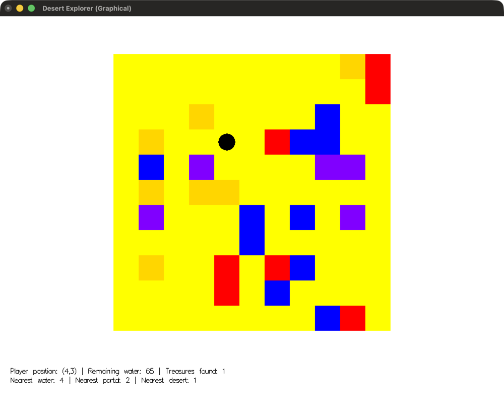

# Haskell Desert Explorer

A small exploration game written in Haskell for the Functional Programming course.
You wander an infinite, procedurally generated desert looking for treasures. Every step costs
water, lava kills you, and stepping on a portal gets you out.

The game has a graphical mode (Gloss) and a terminal mode.



The same position in terminal mode:

```
.........TL
..........L
...T....W..
.T..@.LWW..
.W.P....PP.
.T.TT......
.P...W.W.P.
.....W.....
.T..L.LW...
....L.W....
........WL.

Player position    : (4,3)
Remaining water    : 65
Treasures found    : 1
Nearest water      : 4
Nearest portal     : 2
Nearest desert     : 1
```

## Build and run

You need GHC and cabal (for example via [GHCup](https://www.haskell.org/ghcup/)).

```bash
cabal run desert-explorer                      # GUI, default configuration
cabal run desert-explorer -- --terminal        # terminal mode
cabal run desert-explorer -- 5 100 44 10 10 5 5 20
```

Arguments (all integers, optional as a group):

| # | Name             | Meaning                                              |
|---|------------------|------------------------------------------------------|
| 1 | `sight`          | How many tiles you see around you                    |
| 2 | `maxWater`       | Water capacity (each move costs 5)                   |
| 3 | `seed`           | Map seed                                             |
| 4 | `treasure%`      | Chance that a desert tile hides a treasure           |
| 5 | `water%`         | Chance of a water tile                               |
| 6 | `portal%`        | Chance of a portal tile                              |
| 7 | `lava%`          | Chance of lava when no adjacent tile is lava         |
| 8 | `surroundedLava%`| Chance of lava when the tile above or left is lava   |

`water% + portal% + lava%` and `water% + portal% + surroundedLava%` must not exceed 100.

## Controls

`W` `A` `S` `D` to move. `Esc` closes the GUI window.

## Map

| Tile     | Terminal | GUI    | Effect                         |
|----------|----------|--------|--------------------------------|
| Player   | `@`      | black  |                                |
| Desert   | `.`      | yellow |                                |
| Treasure | `T`      | gold   | +1 treasure                    |
| Water    | `W`      | blue   | Refills your water             |
| Portal   | `P`      | violet | You win                        |
| Lava     | `L`      | red    | You lose                       |

## Magic compass

Below the map, the compass shows how many moves it takes to reach the nearest water, portal
and desert tile without walking through lava (breadth-first search, up to 30 moves).

## Project layout

- `DesertExplorer/Game.hs`: game state, map generation, movement, compass
- `DesertExplorer/GUI.hs`: Gloss interface
- `DesertExplorer/Terminal.hs`: terminal interface
- `DesertExplorer/Main.hs`: argument parsing, picks the mode
